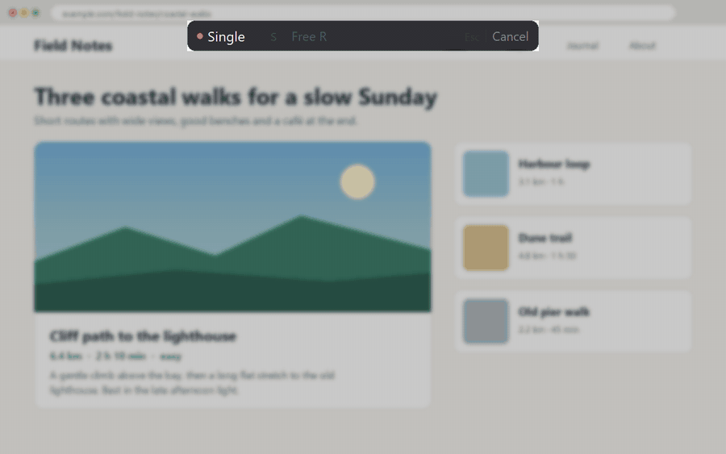

# Screenshot Tool

A keyboard-first region capture and screen recorder for Windows: press Ctrl+Shift+P, drag a box, done.

- **Three capture modes:** a single screenshot, a scrolling capture stitched into one tall image, or a screen recording saved as MP4 or GIF.
- **Presentation backdrops:** recordings can sit on a gradient backdrop (Auto, Indigo, Sunset, Light, Mono) with rounded corners and a shadow, previewed live while you select.
- **Clipboard-ready:** every capture lands on the clipboard and in a folder, and Ctrl+Shift+V types the file path into any input, handy for chat apps and AI tools that take a path.



## Why I built it

I'm a product designer, and I capture and record UI all day. On Mac I'd use CleanShot; on Windows I couldn't find anything that was this quick: one hotkey, drag, and the result is already on the clipboard with a decent backdrop for sharing. So I wrote the small tool I wanted, in Python, and it has been my daily capture tool since.

## Requirements

- Windows 10 or 11 (it uses Win32 APIs directly; it will not run on macOS or Linux)
- Python 3.10 or newer, with tkinter (included in the python.org installer)
- ffmpeg, for recordings. Installed automatically with the `imageio-ffmpeg` Python package, so there is nothing extra to set up.

## Install

```powershell
git clone https://github.com/jkahn24/screenshot-tool.git
cd screenshot-tool
powershell -ExecutionPolicy Bypass -File setup.ps1
```

`setup.ps1` creates a `venv` in the folder and installs `requirements.txt` (Pillow, pywin32, pystray, imageio-ffmpeg). It uses the `py` launcher if present, else `python` on PATH; set the `PYTHON` environment variable to a full path to choose another one.

## Run

```powershell
venv\Scripts\pythonw.exe launcher.py
```

`launcher.py` is a tiny background process that owns the global hotkey and starts the main tool (`screenshot_tool.py`, which shows a tray icon) when needed. On first run the tool adds two shortcuts: one in your Startup folder so the launcher starts at login, and one in the Start Menu. Delete `ScreenshotTool.lnk` from `shell:startup` if you don't want it at login.

## Hotkeys

| Where | Key | Action |
|---|---|---|
| Anywhere | Ctrl+Shift+P | Freeze the screen and start a capture |
| Anywhere | Ctrl+V | Paste the last capture (it is on the clipboard) |
| Anywhere | Ctrl+Shift+V | Type the file path of the last capture (for 30 seconds after capturing) |
| Capture overlay | Drag | Select a region |
| Capture overlay | S | Cycle mode: Single, Scrollable, Recording |
| Capture overlay | F | Recording format: MP4 or GIF |
| Capture overlay | B / Shift+B | Cycle the backdrop forwards / backwards |
| Capture overlay | R | Cycle a locked aspect ratio |
| Capture overlay | Enter or Space | Confirm the selection |
| Capture overlay | Esc | Cancel |
| While recording | Pause / Stop buttons | Shown outside the recorded region |

## Config

No config file is needed. One optional environment variable:

| Variable | Default | Meaning |
|---|---|---|
| `SCREENSHOT_TOOL_DIR` | `%USERPROFILE%\Downloads\Screenshots` | Where captures are saved |

The shutter sound is optional: drop any short `.wav` at `sounds/shutter_hard_click.wav`. Without it the tool generates a synthetic click.

## Privacy

Nothing leaves your machine. There are no network calls; captures are written to the save folder and the clipboard only. Small debug logs go to `%TEMP%\screenshot_tool.log` and `%TEMP%\screenshot_launcher.log`.

## Limitations

- Windows only, and tested on one machine with a mix of scaled and unscaled monitors; unusual multi-monitor DPI setups may misalign the selection.
- Scrollable capture scrolls the window under the selection automatically and stitches the frames; it works best on plain scrolling pages and can struggle with sticky headers or animated content (capped at 60 frames).
- Recording has no audio.
- The global hotkey (Ctrl+Shift+P) is fixed in code; change it in `launcher.py` if it clashes with an app you use.

## Licence

MIT, see [LICENSE](LICENSE).
